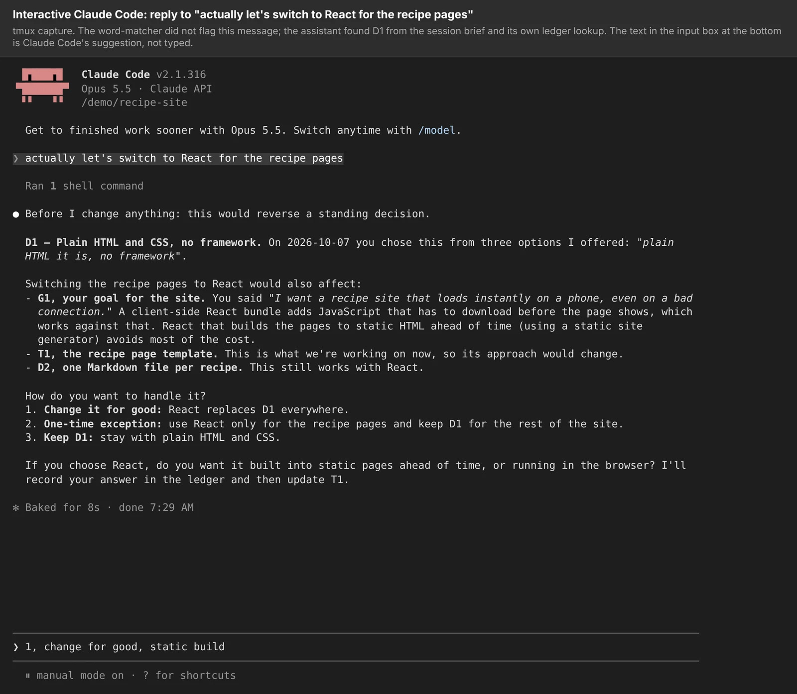
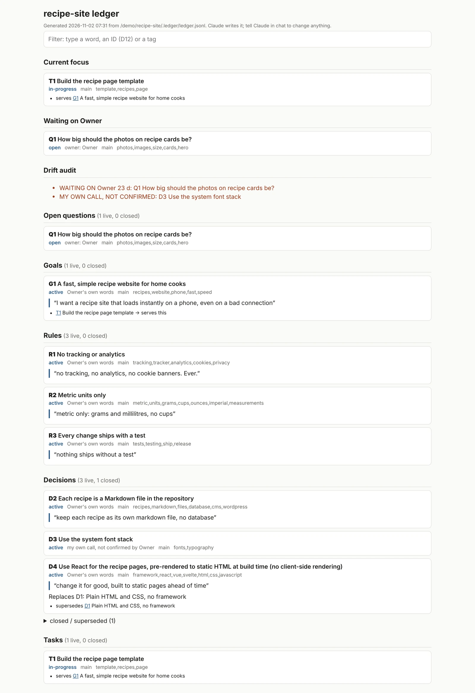

# Page text: ledger

> **For the session building joshuahickson.org.** This is the page body, in Josh's voice. Josh's own words are in
> quotation marks and marked *(Josh's words)*; everything else was written by an agent in his voice, as his rule R2
> allows. Two places are marked **QUESTION FOR JOSH**: they're waiting on his answers (listed in
> `HANDBACK-NOV4.md`). Until he answers, leave those two blocks out of the page; don't invent text for them. The page
> works without them. Images and alt text: `MEDIA.md`. Links: `LINKS.md`. The look is Josh's call (R5): nothing here
> sets it. Everything below the line is page text; delete this box.

---

## ledger

**A record of what I tell my AI coding agents, in my own words, that every new session reads first.**

Directed by Josh. AI agents (Claude Code) wrote the code, tests and documentation under my direction.

### Why I built it

"I built ledger because I needed a lightweight tool to help me effectively track and manage my decisions within
claudecode sessions." *(Josh's words)*

When I work with agents over several days, sessions end or get summarised to save space, and something I decided
last week can quietly drop out. ledger writes each instruction, rule and decision down word for word, with the date
and whose call it was. Every new session gets a short brief of them before it starts. If a new message seems to go
against one of them, the agent is told to quote what I said and when, and ask me: change it for good, make an
exception this once, or keep it?

### What it looks like

*Asked to "switch to React", the agent stops, quotes the earlier decision with its date, and asks before changing
anything.*

*My view of the record: every rule and decision, whose words they were, and what replaced what.*

Both pictures use a made-up recipe-website project, not my real record.

### Where it is now

The first version kept one record per repository. That stopped working once I started using cloud sessions: a cloud
session only sees the one repository it was started on, so it couldn't see rules I'd set while working somewhere
else. So the newest version keeps one shared record in a hosted database, and every session, on my computer or in
the cloud, reads and writes the same one.

That shared record is what I'm using right now to update my entire portfolio, with several agent sessions working at
the same time. Late on 2 November it held 86 items across 14 projects, plus rules that apply to all of them, like
how my work is described and what stays private. The session that drafted this page started by reading it, and
while it worked, other sessions added 40 items across 5 projects in under five minutes.

That's days of real use, not months, and I'm saying so.

### What I've checked, and what I haven't

- **Its own tests pass:** 55 checks for the core tool and 44 for the shared version, run again on 2 November.
- **In test sessions with ledger installed**, each time a message went against a rule, the agent named the rule and
  asked before acting.
- **Against a plain rules file, twice, with mixed results.** I gave an agent the same rules in an ordinary CLAUDE.md
  file, with no ledger, and the same "switch to React" message, in two separate runs on 2 November. In the first, it
  noticed the conflict and asked, but laid out a React plan in the same reply. In the second, it started rewriting
  the decision in the file without asking, then ran out of turns. One run each time: those are examples, not
  results.
- **The warning on each message is weak.** It matches words against tags. On the sample project it caught 1 of 7
  messages that went against a rule; it missed "add Google Analytics" against "no tracking or analytics". In the test
  sessions the agent still caught those, because the start-of-session brief lists every rule. The brief does most of
  the work.
- **The main claim is untested.** ledger is meant to help most in long sessions and after summarising. I haven't
  tested either yet. And in the cloud session that drafted this page, the brief was loaded by a one-line instruction
  rather than by ledger's hooks, so the per-message warning wasn't running.

> **QUESTION FOR JOSH (Q2 in the handback): what it cost.** You said yes to rough numbers. Leave this out until you
> answer. The only figure in the repository is about $0.70 of API use for six short test sessions.

### Lessons

> **QUESTION FOR JOSH (Q1 in the handback): what you learned.** Leave this section out until you answer in your own
> words.

### Links

- The code and README: [github.com/joshhickson/ledger](https://github.com/joshhickson/ledger)
- How the screenshots and test sessions were made:
  [showcase/demo](https://github.com/joshhickson/ledger/tree/main/showcase/demo)
