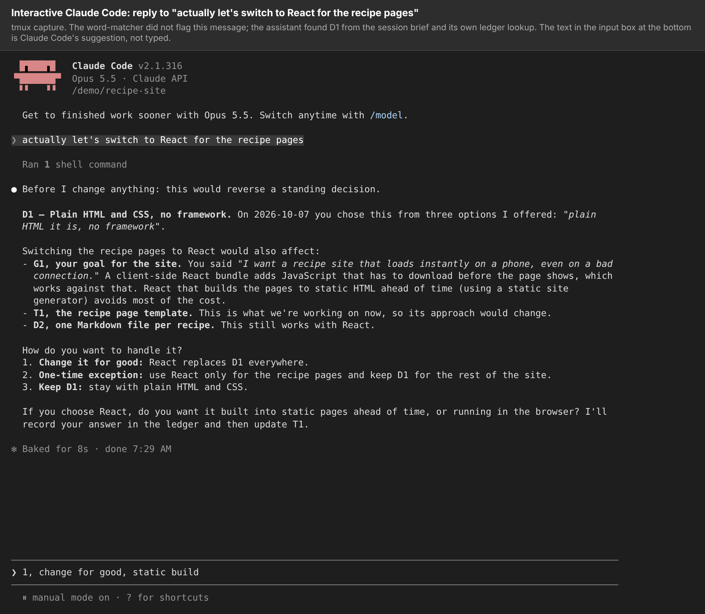
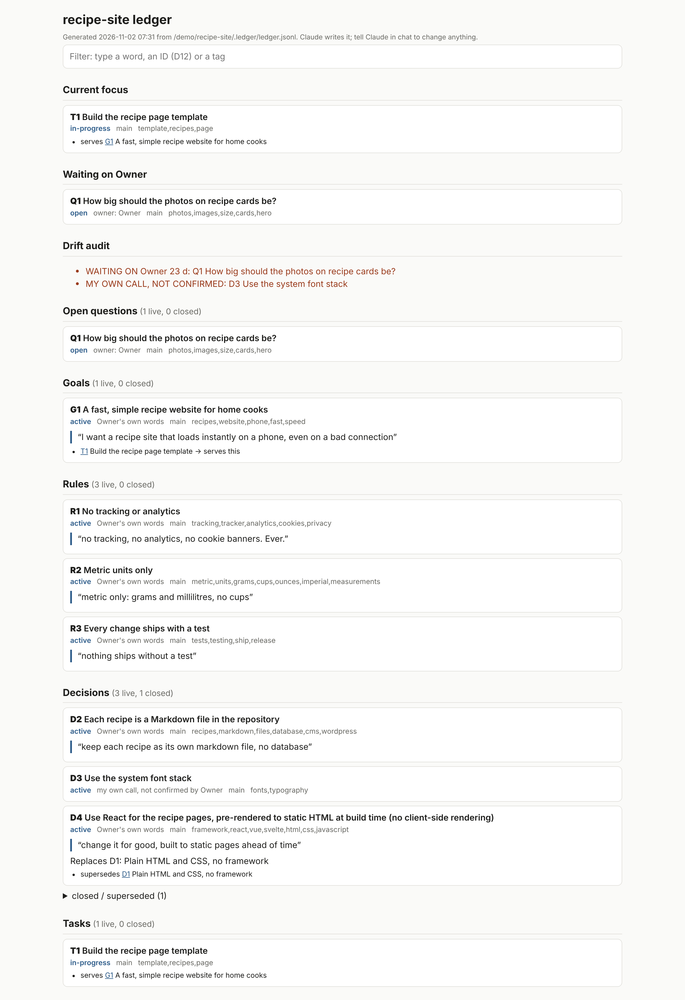

# ledger: draft portfolio page

> Draft by an AI agent, 2 November 2026. Marks: **[Checked: source]** = the agent opened the file or page, or ran
> the thing, itself. **[Inferred]** = judgment. **[Unknown]** = can't be settled from here. Remove the marks before
> publishing, or keep them as a feature. Slots marked **[JOSH: …]** are for Josh's own words. Images are in
> `showcase/demo/screenshots/`.

---

## ledger

**Keeping an AI coding assistant to what you actually said.**

When you work with an AI coding assistant over days, it loses track of earlier instructions. A rule from last week, or
a choice between two options, gets dropped when a session ends or is summarised. ledger writes each instruction,
rule and decision down word for word in a file kept with the project. Each new Claude Code session gets a short brief
of them. When a new message seems to change one, the assistant is told to quote the earlier words with their date and
ask: change it for good, make a one-time exception, or keep it? [Checked: README.md, LEDGER.md, `ledger.py`]

[JOSH: why you built it. The moment or pattern that made you want this, in a sentence or two.]

### What it looks like

*Asked to "switch to React", the assistant stops, quotes the earlier decision with its date, and asks.*

*The owner's view: every rule and decision, whose words they were, and what replaced what.*

All examples use a made-up recipe-website project. [Checked: `demo/make-sample-record.sh`]

### What works, and the evidence

- **Its own tests pass:** 55 of 55, including a real two-branch git merge of the record. [Checked: ran
  `test_ledger.py`]
- **The hooks work in real Claude Code.** In six test sessions with the ledger installed (five headless, one
  interactive, Claude Code 2.1.316), the session-start brief and the per-message check reached the assistant. Each
  time a message went against a rule, the assistant named the rule and asked before acting. [Checked:
  `demo/SESSIONS.md`, screenshots 3 to 5]
- **Compared with a plain rules file, once:** the same rules written into an ordinary CLAUDE.md, with no ledger, and
  the same "switch to React" message. The assistant went straight to rewriting the decision in the file without
  asking. That is one run each way: an example, not a result. [Checked: `demo/SESSIONS.md`, run `react-plain`]
- **Setup takes minutes.** The "try it in five minutes" steps in the README were run as written. [Checked: README.md
  and the run log]

### What doesn't work yet

- **The warning itself is weak.** It matches words against the tags a rule was saved with. On the sample record it
  flagged 1 of 7 contradicting messages; it missed "add Google Analytics" against "no tracking or analytics".
  [Checked: `demo/MATCHER-RESULTS.md`]
- **The brief carried the cases the warning missed.** In those sessions the assistant still asked about React and
  analytics because the session-start brief lists every rule. [Checked: `demo/SESSIONS.md`] [Inferred: that the brief
  is the cause]
- **The main claim is untested.** The ledger is meant to help most in long sessions and after summarising. Neither
  was tested, and this version hasn't been used day to day. [Checked: what was run]

### Who did what

AI coding agents (Claude Code) designed and wrote all of the code, tests and documentation under Josh's direction.
[Checked: README.md] The repository's own
record is thin: one squashed commit under Josh's account, co-authored by Claude, and a licence in his name. Nothing in
it says who proposed which idea. [Checked: `git log`, LICENSE] The code still converts an older ledger's labels and
has an `import` command for an earlier multi-project version, so there was at least one earlier version.
[Checked: `ledger.py` `norm_basis`, `cmd_import`] [Inferred: that it was used before this rewrite]

[JOSH: what you decided. For example, which of these were your calls: recording your words verbatim, the three-way
"change / exception / keep" question, flagging the assistant's own unconfirmed decisions, the move from one shared
ledger to one per repository. Only claim what you remember deciding.]

### What's unusual about it

Memory tools for coding assistants are a crowded field. Claude Code already loads the project's CLAUDE.md into every
session and re-reads it after `/compact`. [Checked: code.claude.com/docs/en/memory] At least one other hook-based
system already checks each message against stored rules and re-injects decisions after summarising, and it reports
before-and-after counts over 1,300+ sessions. [Checked: dev.to write-up on "claude-brain"] So the per-message check
alone is not new.

What is less common is the stance: **the owner's own words outrank the assistant's plans.**

- Every item records whose call it was: the owner's words, the owner picking the assistant's suggestion, or the
  assistant's own unconfirmed call. [Checked: `ledger.py` `BASES`]
- The assistant's unconfirmed decisions are flagged in an audit. [Checked: `ledger.py` `audit`; screenshot 1]
- A change is never silent in either direction. The assistant must neither just comply nor just refuse. It quotes
  you, asks, and records the answer as a replacement or a one-time exception. [Checked: LEDGER.md, `cmd_override`;
  screenshot 5]

The analysis that preceded this page found no other tool built around that protocol. That is a search result, not
proof. [Inferred]

### Lessons

[JOSH: what you learned. For example, about directing agents, or about what a rules file can and can't do. Your own
words; a few sentences.]

### Links

- Code and README: github.com/joshhickson/ledger
- Test sessions, screenshots and how they were made: `showcase/demo/` on the `portfolio/showcase` branch

[JOSH: confirm the links once you decide which branch the public page points to.]
